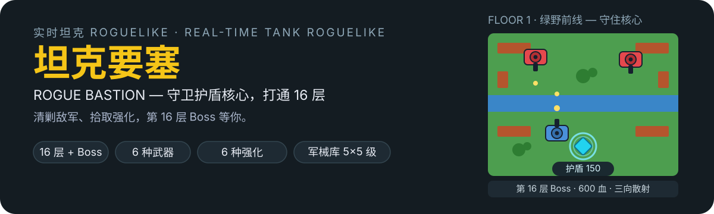
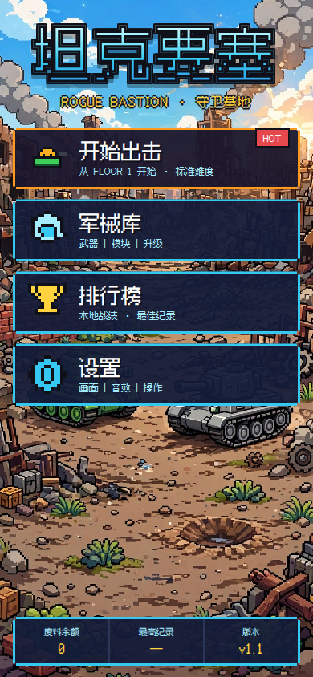
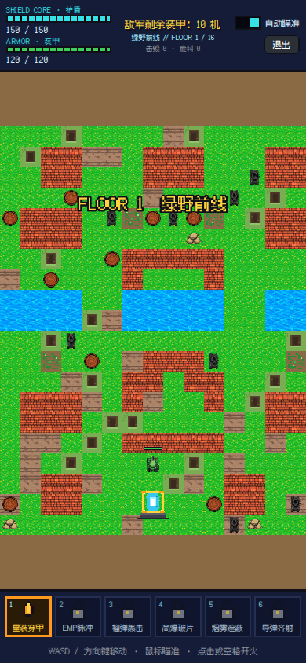

<p align="right"><a href="README.md">中文</a></p>

<p align="center">
  
</p>

<p align="center">
  <a href="https://holynova.github.io/rogue-bastion/">▶ Play Online</a>
  ·
  <a href="https://github.com/holynova/rogue-bastion">GitHub Repository</a>
</p>

Rogue Bastion is a real-time tank roguelike: drive your tank floor by floor, clear every enemy, and defend the shield core (150 HP). Pick one of three upgrades after each cleared floor, survive all 16 floors, and take down the floor-16 boss. Mobile-first with touch joystick and auto-aim; zero build, Phaser 3 + pure JavaScript.

## Screenshots

<p align="center">
  
  
</p>

## How to Play

- **Combat**: WASD / arrow keys to move, mouse to aim, click or Space to fire; on mobile, touch joystick + fire button with auto-aim on by default.
- **Objective**: wipe out every enemy on each floor (10–30 units) and protect the shield core (150 HP). The run ends if the core is destroyed or your tank is wrecked.
- **Upgrades**: after each cleared floor, draft one of three (6 in total: split barrel / high-explosive shells / nano repair / high-velocity armor-piercing shells / reinforced composite armor / dual auto-loader); one reroll per round.
- **Floors**: 16 floors, each with its own name and look (绿野前线 Greenfield Front, 河谷裂带 Rift Valley, 钢铁要塞 Steel Bastion … 终焉防线 Final Defense Line, 王座要塞 Throne Bastion), cycling through three themes — greenfield / valley / steel; 4 enemy types (侦察 Scout / 突击 Assault / 重装 Heavy / 导弹 Missile), growing in count and HP with depth.
- **Boss**: floor 16, Throne Bastion — 600 HP, triple spread shot, summons minions.

## Systems

- **6 weapons**, unlocked by highest floor reached: armor-piercing (F1), EMP pulse (F2, area stun), grenade barrage (F3, fires over cover), frag shot (F5, fan spread), smoke screen (F7, 5s stealth), missile volley (F10, tracks 4 targets).
- **Armory**: permanent upgrades, 5 tracks × 5 levels each (armor cap / cannon damage / engine power / fast reload / core shield), bought with scrap earned in runs and kept across runs.
- **Local leaderboard**: every run records floors reached, kills, scrap, time, and win/loss.
- **Sound**: 12 synthesized Web Audio effects (fire / hit / explosion / pickup / clear / win-lose / EMP / missiles, and more) — no audio files.

## Run Locally

Zero build — serve it statically (opening the file directly fails to load image assets due to browser security policy):

```bash
python3 -m http.server 8000
# Open http://localhost:8000
```

Logic tests (89 cases, run directly with Node):

```bash
node tests/test-logic.js    # 83 cases: maps / floors / drafts / upgrades / kill streaks
node tests/test-sound.js    # 6 cases: sound synthesis
```

## Tech

- Phaser 3.90 (vendored locally, `js/phaser.min.js`) + pure JavaScript, zero build, zero dependencies.
- The rules core is pure functions (`js/logic.js`), testable in Node; data-driven (weapons / upgrades / armory / floors all live in data tables in `js/logic.js`).
- Art: AI-generated pixel image assets (`assets/`: 6 tank hulls + turrets, 4 terrain tiles + theme variants, 3 decorations, menu background), magenta-keyed into Phaser textures; `js/sprites.js` keeps a hand-drawn code version as a load-failure fallback.
- Font: Fusion Pixel (SIL OFL 1.1, see `fonts/OFL.txt`).
- Balance baseline: holynova/battle-city-roguelike (design numbers only; code and art fully redone).

```
index.html          Entry (main menu / combat HUD / upgrade draft / results / armory / leaderboard)
css/style.css       Cartoon pixel style, mobile-first
js/game.js          Phaser scenes: combat, enemy AI, boss, ballistics
js/logic.js         Pure rules core: maps / floors / weapons / upgrades / armory / leaderboard
js/ui.js            UI controller: menu, armory, leaderboard, upgrade drafts
js/sound.js         Synthesized Web Audio effects (12)
js/sprites.js       Art loading (AI-generated pixel images + hand-drawn fallback)
tests/              Node tests (83 + 6)
```
