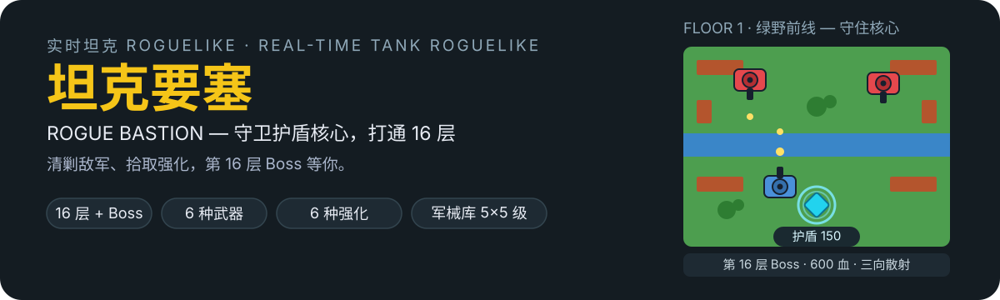
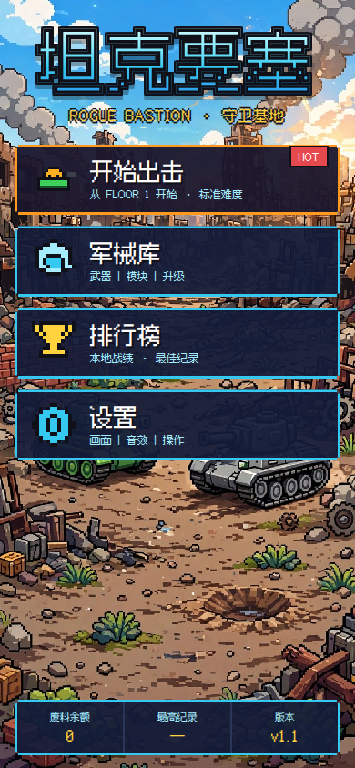
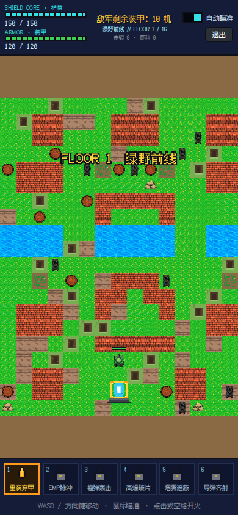

<p align="center">
  
</p>

<p align="center">
  <a href="https://holynova.github.io/rogue-bastion/">▶ 在线玩 Play Online</a>
  ·
  <a href="https://github.com/holynova/rogue-bastion">GitHub 仓库</a>
</p>

坦克要塞是一款实时坦克 Roguelike：开着坦克逐层清剿敌军，守住基地护盾核心（150 点），每清一层三选一强化，一路打通 16 层，挑战第 16 层的 Boss。移动端优先，触屏摇杆 + 自动瞄准，零构建，Phaser 3 + 纯 JS。

Rogue Bastion is a real-time tank roguelike: drive your tank floor by floor, clear every enemy, and defend the shield core (150 HP). Pick one of three upgrades after each cleared floor, survive all 16 floors, and take down the floor-16 boss. Mobile-first with touch joystick and auto-aim; zero build, Phaser 3 + pure JavaScript.

## 截图 / Screenshots

<p align="center">
  
  
</p>

## 玩法 / How to Play

- **战斗**：WASD / 方向键移动，鼠标瞄准，点击或空格开火；手机端触屏摇杆 + 开火键，默认自动瞄准。
- **目标**：消灭每层全部敌军（10–30 机），保护基地护盾核心（150 点）。核心被毁或坦克被击毁即失败。
- **强化**：每清一层三选一（分裂炮管 / 高爆弹 / 纳米修复 / 高膛压穿甲弹 / 加厚复合装甲 / 双路自动装弹机，共 6 种），每轮可刷新 1 次。
- **楼层**：16 层，每层有名有图（绿野前线、河谷裂带、钢铁要塞……终焉防线、王座要塞），绿野 / 河谷 / 钢铁三主题轮换；敌军 4 种（侦察 / 突击 / 重装 / 导弹），数量与血量随楼层递增。
- **Boss**：第 16 层王座要塞，600 血，三向散射，召唤小怪。

## 系统 / Systems

- **6 种武器**，按最高到达楼层解锁：重装穿甲（1 层）、EMP 脉冲（2 层，范围眩晕）、榴弹轰击（3 层，可越掩体）、高爆破片（5 层，扇形霰弹）、烟雾遮蔽（7 层，隐蔽 5 秒）、导弹齐射（10 层，追踪 4 目标）。
- **军械库**：永久升级，5 项各 5 级（装甲上限 / 火炮威力 / 引擎功率 / 快速装弹 / 基地护盾），用对局获得的废料购买，跨对局保留。
- **本地排行榜**：每局记录到达楼层、击杀、废料、用时与胜负。
- **音效**：12 种 Web Audio 合成音效（开火 / 命中 / 爆炸 / 拾取 / 过关 / 胜负 / EMP / 导弹等），无音频文件。

## 本地运行 / Run Locally

零构建，起一个静态服务器即可玩（直接双击打开会因浏览器安全策略加载不了图片资源）：

```bash
python3 -m http.server 8000
# 打开 http://localhost:8000
```

逻辑测试（89 个用例，Node 直接跑）：

```bash
node tests/test-logic.js    # 83 个：地图 / 楼层 / 抽取 / 强化 / 连杀
node tests/test-sound.js    # 6 个：音效合成
```

## 技术 / Tech

- Phaser 3.90（本地 vendored，`js/phaser.min.js`）+ 纯 JS，零构建、零依赖。
- 规则核心是纯函数（`js/logic.js`），可在 Node 跑测试；数据驱动（武器 / 强化 / 军械库 / 楼层均在 `js/logic.js` 的数据表里）。
- 美术：AI 生成的像素图片素材（`assets/`：6 种坦克车体 + 炮塔、4 种地形砖 + 主题变体、3 种装饰物、菜单背景图），品红抠图后作 Phaser 纹理；`js/sprites.js` 保留代码手绘版本作加载失败时的回退。
- 字体：Fusion Pixel（SIL OFL 1.1，见 `fonts/OFL.txt`）。
- 数值底本：holynova/battle-city-roguelike（仅复用设计数值，代码与美术全部重做）。

```
index.html          入口（主菜单 / 战斗 HUD / 强化三选一 / 结算 / 军械库 / 排行）
css/style.css       卡通像素风，移动端优先
js/game.js          Phaser 场景：战斗、敌人 AI、Boss、弹道
js/logic.js         纯规则核心：地图 / 楼层 / 武器 / 强化 / 军械库 / 排行榜
js/ui.js            界面控制器：菜单、军械库、排行榜、强化抽取
js/sound.js         Web Audio 合成音效（12 种）
js/sprites.js       美术素材加载（AI 生成像素图片 + 代码手绘回退）
tests/              Node 测试（83 + 6）
```

## English

**Rogue Bastion** is a real-time tank roguelike: clear every enemy on each floor while defending the shield core (150 HP). After each floor, draft one of three upgrades; survive 16 floors and defeat the floor-16 boss (600 HP, triple spread shot, summons minions).

- **Combat**: WASD/arrows to move, mouse to aim, click or Space to fire. On mobile, touch joystick + fire button with auto-aim on by default.
- **6 weapons**, unlocked by highest floor reached: armor-piercing (F1), EMP pulse (F2, stuns), grenade barrage (F3, over cover), frag shot (F5, 5-pellet spread), smoke screen (F7, 5s stealth), missile volley (F10, tracks 4 targets).
- **Armory**: 5 permanent upgrades, 5 levels each (armor / damage / speed / reload / core shield), bought with scrap earned in runs.
- **Run it**: `python3 -m http.server 8000`, then open http://localhost:8000. Tests: `node tests/test-logic.js` (83 cases) and `node tests/test-sound.js` (6 cases).
- **Tech**: Phaser 3.90 (vendored) + pure JavaScript, zero build. Pixel art is AI-generated (magenta-keyed) with a hand-drawn code fallback. Font: Fusion Pixel (SIL OFL 1.1).
